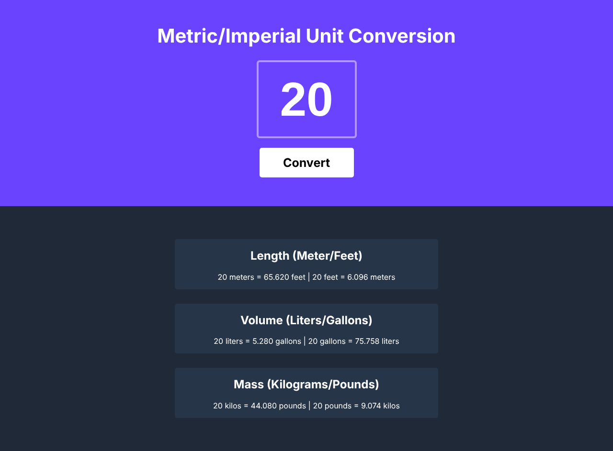

# 📏 Unit Converter

A small web app that converts a number between metric and imperial units: length, volume and mass, both ways, in one click.

Solo project from the [Scrimba Fullstack Developer Path](https://scrimba.com/fullstack-path-c0fullstack) (*JavaScript Fundamentals* module), built from a Figma design provided by Scrimba.

**🌐 Live demo:** [Scrimba Unit Converter](https://scrimconverter.netlify.app)



## ✨ Features

- Type a number and click **Convert**
- **Length:** meters ⇄ feet
- **Volume:** liters ⇄ gallons
- **Mass:** kilograms ⇄ pounds
- Results rounded to 3 decimal places
- Responsive layout that works on desktop and mobile

| Conversion | Factor |
|---|---|
| 1 meter | 3.281 feet |
| 1 liter | 0.264 gallon |
| 1 kilogram | 2.204 pounds |

## 🛠️ Built with

- HTML5
- CSS3 (Flexbox, Google Fonts: Inter)
- Vanilla JavaScript (no framework, no library)

## 🧠 What I practiced

- Listening for clicks with `addEventListener()`
- Reading an input with `.value` and converting it with `Number()`
- Rendering results with template strings
- Rounding numbers with `toFixed()`
- Storing fixed values in `const` variables

## 🚀 Run it locally

```bash
git clone https://github.com/Hushhhy/simpleUnitConverter.git
cd simpleUnitConverter
```

Then open `index.html` in your browser. No installation needed.

## 📁 Project structure

```
simpleUnitConverter/
├── index.html
├── style.css
├── script.js
└── images
    └── screenshot.png
```

## 🙏 Credits

- Project brief and design: [Scrimba](https://scrimba.com)
- Built by [Alexis Carpentier](https://github.com/Hushhhy)
